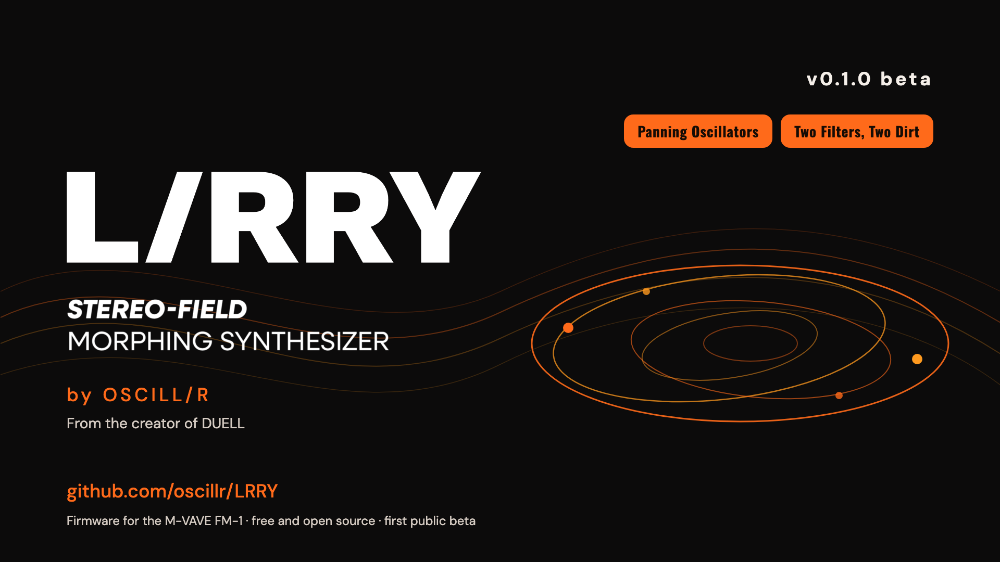

# L/RRY

**Stereo-Field Morphing Synthesizer**  
**by OSCILL/R**

**Every voice is a stereo field.** L/RRY is free, open-source firmware (GPL-3.0) for the M-VAVE FM-1. Each note gets two oscillators, a sub, noise and ring modulation, two filters and two dirt stages, and every one of them has its own place left and right. Modulate the pans and the sound moves around you. A morph glides between two versions of every sound. This is **L/RRY 0.1.0 beta**, the first public beta.

**Try it in your browser, no FM-1 needed:** <https://oscillr.github.io/LRRY/emu/>

> **This is a beta.** L/RRY works and plays clean on the author's unit, but it is new. Expect rough edges and tell us what you find. Until version 1.0 the way patches and settings are saved may change, and a backup made with one version may not restore in the next.

> **Install at your own risk.** L/RRY has run on **one FM-1, the author's**. The way back to the official firmware (V15) is the same as for DUELL and has worked for the author. The FM-1 has a single copy of its firmware and no known rollback. Back up first. No warranty. L/RRY is not affiliated with M-VAVE.

## Install and update

1. Use **Chrome or Edge** on a computer (the installer needs WebMIDI with SysEx), a **data** USB cable straight into the computer (no hub), and an FM-1.
2. Open the installer page: <https://oscillr.github.io/LRRY/install/>. Save a backup, press Install, wait for Done, then switch the unit off and on once.
3. Do not unplug while the firmware is written. If the screen stays dark the write may still be running: wait for the installer to say Done.
4. Going back: the installer's **Return to official V15**, or M-VAVE's own updater.

The package is `lrry-0.1.0-beta.fwsc` (compare its SHA-256 with `SHA256SUMS` on the release page).

## What is in it

### The stereo voice
Every note plays through the whole chain below, in stereo.

| Stage | What it does |
|---|---|
| **OSC 1, OSC 2** | Eight models each: SAW, TRI, SINE, PULSE, SYNC, SUPER (up to seven saws with detune and spread), FM and WAVEFOLD. COARSE, FINE and up to three model controls. |
| **SUB OSC** | SINE, TRI, SQUARE or PULSE, an octave or two down, its own level and pan. |
| **NOISE, RING** | White, pink or brown noise, and OSC 1 x OSC 2 ring modulation. |
| **Every source** | Its own LEVEL, PAN and FILTER BALANCE (how much goes to the MULTI FILTER and how much to the TWIN FILTER). |
| **MULTI FILTER** | LP, BP, HP or NOTCH, 12 or 24 dB, key tracking, envelope and LFO depth, its own pan. |
| **TWIN FILTER** | OFF, LP, BP, HP, NOTCH, LADDER or COMB, its own cutoff or LINK to the MULTI FILTER, its own pan. SERIES or PARALLEL with the MULTI FILTER. |
| **DIRT A, DIRT B** | SOFT, HARD, FOLD, FUZZ or CRUSH, each with DRIVE, LEVEL and its own pan. SERIES or PARALLEL. |
| **MID / SIDE** | How wide the voice is, per patch. |

### Movement
- **AMP ENV**, **ENV 2** and the **CYCLE** envelope (it can loop and run as a modulation source).
- **LFO 1** and **LFO 2**, free or synced to the tempo, with their own trigger and fade.
- An **8-slot modulation matrix** that can reach every pan, the model controls, both filters and both dirt stages.
- **MORPH**: glide between two versions of the same patch with one fader. End A is the sound; End B is rolled from it by a smart randomizer (ROLL, UNDO, AMOUNT). The ALGORITHM knob moves the morph on every page (MENU > CONTROL > ALGORITHM KNOB picks what it turns).

### Playing
POLY, MONO and LEGATO, glide, an arpeggiator, chords with STRUM, scales, and the 64-step sequencer with parameter locks. Key velocity and aftertouch.

### Effects
A stereo **CHORUS**, a **DELAY** with four modes (DIGITAL, PING-PONG, RANDOM, OCTAVE UP) and six **REVERB** types (ROOM, SPRING, HALL, SHIMMER, RESONATOR, PLATE). The patch sets how much it sends to each on the FX page. **STEREO MASTER** has WIDTH and BASS MONO.

Effects cost voices. **GLO > MODULES > SENDS OFF** switches them off and gives every voice back.

### Voices
Both cores of the FM-1 play voices. The number on the screen is always what really plays, and it never promises more than you hear.

### Patches
**128 patches**: 6 BASS, 28 LEAD, 32 PAD, 4 PLUCK, 32 KEYS, 2 PERC, 24 FX. Every one uses both filters, both dirt stages and moving pans. Save your own into any of the 128 slots.

### Editor
A web editor for every page and the patch librarian: <https://oscillr.github.io/LRRY/editor/> (Chrome or Edge, USB).

## Known limits in the beta
- One part. L/RRY puts everything into one stereo voice instead of DUELL's two parts.
- Panning every stage hard to opposite sides in SERIES can cancel the sound. That is the pan law doing what it says.
- When too many keys are held for the voices on screen, a voice fades out instead of crackling.

## Read more

| I want to... | Read |
|---|---|
| See every page and control | [SPEC.md](SPEC.md) |
| See what changed | [CHANGELOG.md](CHANGELOG.md), [RELEASE_NOTES.md](RELEASE_NOTES.md) |
| Report a bug | the [issues page](https://github.com/oscillr/LRRY/issues) |

## Credits and licence

L/RRY is built on **DUELL** by OSCILL/R, which is a fork of **Felucca** by Leo Kuroshita (@kurogedelic), Hügelton Instruments. It is licensed under the **GPL-3.0-only** ([LICENSE](LICENSE)). The L/RRY logo and artwork are the work of OSCILL/R and are not part of the GPL licence. L/RRY is an independent project and is not affiliated with M-VAVE.
